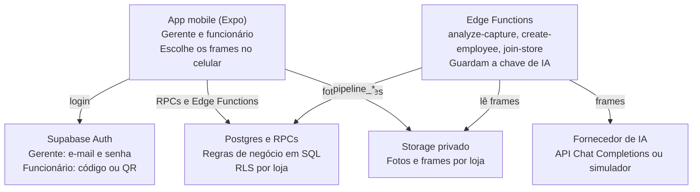
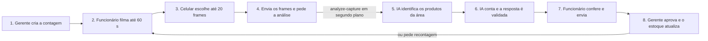

# ContaBot Mobile: arquitetura e plano de execução

## Resumo

O ContaBot virou um app mobile em Expo com backend no Supabase, e a maior parte do MVP já está no repositório desde o PR #1 do Walter, de 10/11/2026. Os 20 dias agora servem para validar o que existe, ligar a IA real, testar em aparelhos e preparar a entrega.

O app atende dois papéis. O gerente cadastra produtos, divide a loja em áreas, cria contagens e aprova os números. O funcionário vê o que contar, filma, confere a sugestão da IA e envia.

**Situação em 10/11/2026**

| Verificação | Resultado |
| --- | --- |
| Testes unitários das Edge Functions | 33 de 33 passaram |
| Checagem de tipos do app | Passou |
| Teste de ponta a ponta com Supabase local | 2 de 2 passaram, com IA simulada |
| App em celular real | Não testado |
| IA real | Não testada; o padrão é o simulador |

**O MVP está pronto quando, em um celular real:**

1. O gerente cria a loja, cadastra um produto com fotos e monta uma área.
2. O gerente cria um funcionário, e ele entra pelo código de acesso.
3. O funcionário filma até 60 segundos e recebe a sugestão da IA.
4. O funcionário confere e envia; o gerente aprova e o estoque é atualizado.
5. Uma pessoa de outra loja não enxerga nada disso.

**Premissas deste plano**

- **Prazo:** 20 dias, para trabalho da faculdade. A meta é ter o MVP funcionando por volta do Dia 13.
- **Equipe:** 3 das 6 pessoas do grupo, uma por frente.
- **Base:** o código do PR #1. O contrato completo está em [arquitetura.md](arquitetura.md).
- **Distribuição:** APK no Android e Expo Go no iPhone, sem publicar nas lojas agora.
- **Conexão:** uso online. A fila offline citada em `arquitetura.md` não foi encontrada no código.

## Decisões de arquitetura

Não existe mais servidor próprio. O app fala direto com o Supabase, que concentra login, banco, regras de negócio, arquivos e a chamada à IA.

| Área | Decisão atual | Por que ajuda |
| --- | --- | --- |
| App | Expo SDK 58, Expo Router, TanStack Query e `supabase-js` | Uma base para Android e iPhone |
| Captura | `expo-camera`, até 60 segundos | Roda no Expo Go |
| Seleção de frames | No celular, com `expo-video` e `jpeg-js`; até 20 JPEG de até 1920 px | O vídeo nunca sobe, então o limite de 50 MB deixa de importar |
| Regras de negócio | RPCs em SQL no Postgres | Sem servidor para hospedar e manter |
| Análise | Edge Function `analyze-capture`, em Deno, uma invocação por etapa | Cabe no limite de tempo das Edge Functions |
| Segurança | RLS por loja; nenhuma escrita direta nas tabelas | O banco bloqueia acesso cruzado |
| Login | Gerente com e-mail e senha; funcionário com código de acesso ou QR | Funcionário não precisa de e-mail |
| Arquivos | Bucket privado `media`, com pastas por loja e URLs assinadas por 1 hora | Fotos e frames não ficam públicos |
| IA | Qualquer API compatível com Chat Completions, configurada por `VISION_*`; simulador por padrão | Troca de fornecedor sem mudar código |
| Contrato | [arquitetura.md](arquitetura.md) | Documentação junto do código |

**Decisões em aberto**

| Decisão | Recomendação | Necessária até |
| --- | --- | --- |
| Login | Gerente com e-mail; funcionário com código de acesso | Decidido |
| Catálogo por loja ou por rede | Catálogo separado por loja | Decidido |
| Repositório | Usar o repositório atual | Decidido |
| Fornecedor e modelo de IA | Usar gpt-5.6-luna e validar com um vídeo real | Dia 2 |
| Projeto Supabase na nuvem | Criar no plano Free e publicar migrações e funções | Dia 2 |
| Fila offline de envio | Está documentada, mas não implementada; decidir se entra | Dia 2 |

## Arquitetura geral

O app conversa só com o Supabase: login no Auth, dados pelas RPCs e imagens pelo Storage. A IA é chamada apenas pela Edge Function, que guarda a chave.



### Fluxo de uma contagem

O celular escolhe os frames e envia só eles. A análise roda em segundo plano na Edge Function, e o app consulta o andamento a cada 1,5 segundo.



Se a análise falhar ou nada for reconhecido, o funcionário confere manualmente no passo 7. Uma contagem pode ter várias capturas. A sugestão da IA, o número conferido pelo funcionário e o número aprovado pelo gerente ficam em campos separados.

### Tenant, login e permissões

- **Loja:** cada loja é um tenant em `stores`, e as tabelas carregam `store_id`.
- **Gerente:** cria a conta pelo cadastro do app, que também cria a loja.
- **Funcionário:** é criado pelo gerente e entra com código de acesso ou QR. O código fica guardado só como hash.
- **Papéis:** cada RPC confere se a pessoa é gerente ou funcionário.
- **RLS:** membros ativos só leem dados da própria loja, e toda escrita passa pelas RPCs.
- **Arquivos:** bucket privado `media`, com pastas por loja. Só o gerente envia fotos de produto.

### Comunicação com a IA

- A chave fica nos segredos da Edge Function, em `VISION_API_KEY`. O app nunca a recebe.
- O celular envia só os frames escolhidos; o vídeo fica no aparelho.
- Identificação e contagem rodam em invocações separadas, e `pipeline_claim` impede análise duplicada.
- A resposta passa por esquema estrito, com as regras do antigo `domain.py`.
- O simulador é o padrão. A IA real exige configurar as variáveis `VISION_*`.

### Conexão

- O app precisa de conexão para enviar e consultar.
- `arquitetura.md` descreve uma fila offline de envio, mas ela não foi encontrada no código. A decisão fica para o Dia 2.
- Se a análise falhar, o funcionário cai na conferência manual e não fica travado.

### Regras de produto que continuam valendo

Estas regras vieram do MVP web e estão cobertas pelos testes de `vision.test.ts`.

- Contagens de frames sobrepostos nunca são somadas, porque podem repetir caixas.
- “Não identificado” e quantidade desconhecida não significam estoque zero.
- Sem cobertura completa, o resultado é parcial e exige revisão.
- Toda quantidade observada, inclusive zero, precisa apontar para frames de evidência.
- Não existe total entre vídeos, pois eles podem mostrar as mesmas caixas.
- Produto excluído sai de novas análises, mas o histórico e as fotos das análises antigas ficam preservados.

## Modelo de dados e contrato da API

O contrato completo está em [arquitetura.md](arquitetura.md), mantido junto do código. Esta seção resume o que cada frente precisa saber.

| Grupo | Tabelas |
| --- | --- |
| Lojas e pessoas | `stores`, `profiles`, `access_codes` |
| Catálogo | `products`, `areas`, `area_products` |
| Contagens | `tasks`, `task_items`, `task_events` |
| Análise | `captures` |
| Estoque | `stock_entries` |

A contagem passa por `open`, `analyzing`, `review`, `submitted` e `approved`. Um pedido de recontagem a devolve para `open`.

| Grupo de chamadas | Exemplos |
| --- | --- |
| Equipe | `whoami`, `list_team`, `create-employee`, `join-store`, `deactivate_member` |
| Catálogo | `list_products`, `create_product`, `create_area`, `update_area` |
| Contagens | `create_tasks`, `list_tasks`, `get_task`, `submit_task`, `approve_task`, `request_recount` |
| Captura | `start_capture`, `register_capture_frames`, `analyze-capture`, `switch_to_manual` |
| Painel | `get_dashboard` |

Os nomes com hífen são Edge Functions; os demais são RPCs. Erros chegam em português.

## Estrutura do repositório e padrões de trabalho

O repositório já está reorganizado pelo PR #1. A versão web antiga saiu da `main` e continua no histórico do Git.

```text
contabot/
  mobile/src/app/(auth)/        Login e cadastro do gerente
  mobile/src/app/(employee)/    Contagens, câmera, análise e conferência
  mobile/src/app/(manager)/     Painel, contagens, produtos, áreas e equipe
  mobile/src/services/          API, captura, seleção de frames e imagens
  supabase/migrations/          Tabelas, RLS e RPCs
  supabase/functions/           analyze-capture, create-employee, join-store
  supabase/tests/               Teste de ponta a ponta
  supabase/scripts/seed-demo.ts Dados de demonstração
  docs/                         Arquitetura e este plano
```

**Padrões de trabalho**

- **Branches:** curtas, saindo da `main`, com pull request revisado por outra pessoa.
- **Banco:** toda alteração entra por migração em `supabase/migrations`.
- **Segredos:** chaves só nos segredos do Supabase e em `.env` locais, nunca no repositório.
- **Testes:** `deno test` nas funções e `npx tsc --noEmit` no app. Ainda não há CI.
- **Alinhamento:** 15 minutos por dia e demonstração nos Dias 2, 8, 13 e 18.

## Três frentes de trabalho

As frentes continuam três, mas agora o trabalho é validar e completar o que existe. Os responsáveis ainda precisam ser preenchidos; o Walter é o candidato natural para a frente A, pois escreveu o backend.

| Frente | Responsável | É dona de | Perfil indicado |
| --- | --- | --- | --- |
| **A. Supabase e dados** | A definir | Projeto na nuvem, migrações, RPCs, RLS, seed, teste de ponta a ponta e CI | SQL e Supabase |
| **B. Contagem e IA** | A definir | IA real, prompts, desempenho da seleção de frames, medição de acerto e custo | TypeScript e integração com IA |
| **C. App mobile** | A definir | Testes em aparelhos, ajustes de telas, erros, APK e Expo Go | React Native e TypeScript |

**Pontos de integração**

| O que é entregue | De | Para | Até | Enquanto não chega |
| --- | --- | --- | --- | --- |
| Projeto Supabase na nuvem | A | B e C | Dia 2 | Supabase local |
| Lista de problemas do teste em aparelho | C | A e B | Dia 3 | Cada um testa no navegador ou no Expo Go |
| IA real configurada na nuvem | B | A e C | Dia 5 | Simulador |
| Loja de demonstração com dados | A | B e C | Dia 10 | Seed local |
| APK instalável | C | Todos | Dia 11 | Expo Go |

## Etapas de execução

Como o código já existe, as etapas agora validam, corrigem e estabilizam. A meta é ter o MVP funcionando por volta do Dia 13 e usar o resto para testar com produtos reais e preparar a entrega.

| Etapa | Dias | Frente A | Frente B | Frente C | Marco |
| --- | --- | --- | --- | --- | --- |
| 0. Validar | 1 e 2 | Nuvem e teste ponta a ponta | IA real com vídeo real | App no Android e no iPhone | Tudo rodando na nuvem |
| 1. IA real | 3 a 8 | Correções de RPC e RLS | IA na nuvem e seleção de frames | Correções de telas | Fluxo completo com IA real |
| 2. Estabilizar | 9 a 13 | Loja de demonstração | Ajuste de prompts | Primeiro APK e erros | MVP funcionando |
| 3. Teste real | 14 a 18 | Correções finais | Medição de acerto e custo | Ajustes e APK final | Demonstração funcionando |
| 4. Entrega | 19 e 20 | Arquitetura no relatório | Resultados de acerto | Vídeo de demonstração | Trabalho entregue com plano B |

Os marcos servem para a equipe se situar. Se algo atrasar, ajustamos e seguimos.

### Etapa 0: validar o que existe (Dias 1 e 2)

| ID | Frente | Entrega | Depende de | Resultado esperado |
| --- | --- | --- | --- | --- |
| E0.1 | Todos | Apresentar o PR #1 e fechar as decisões em aberto | Nenhuma | Responsáveis definidos |
| E0.2 | A | Criar o projeto na nuvem e repetir lá o teste de ponta a ponta | Nenhuma | Teste passa e nuvem no ar |
| E0.3 | B | Rodar a IA real com um vídeo real | E0.2 | Sugestão válida e custo do vídeo medido |
| E0.4 | C | Rodar o app no Android e no iPhone | E0.2 | Fluxo do gerente e do funcionário com o simulador |
| E0.5 | A | CI no GitHub Actions | Nenhuma | Pull request roda os testes |

### Etapa 1: IA real e correções (Dias 3 a 8)

| ID | Frente | Entrega | Depende de | Resultado esperado |
| --- | --- | --- | --- | --- |
| E1.1 | C | Registrar os problemas do teste em aparelho | E0.4 | Lista priorizada |
| E1.2 | B | Medir a seleção de frames em um celular simples | E0.4 | Tempo medido e otimizado se necessário |
| E1.3 | B | IA real de ponta a ponta na nuvem | E0.3 | Análise completa sem estourar o tempo |
| E1.4 | A | Corrigir problemas de RPC e RLS | E1.1 | Lista do backend resolvida |
| E1.5 | C | Corrigir telas e erros | E1.1 | Lista do app resolvida |
| E1.6 | A e C | Implementar a fila offline ou tirá-la da documentação | E0.1 | Código e documentação coerentes |

**Marco do Dia 8:** o fluxo do gerente ao estoque funciona na nuvem com IA real.

### Etapa 2: estabilizar (Dias 9 a 13)

| ID | Frente | Entrega | Depende de | Resultado esperado |
| --- | --- | --- | --- | --- |
| E2.1 | A | Loja de demonstração na nuvem | E1.4 | Produtos, áreas e equipe prontos |
| E2.2 | B | Ajustar prompts com vídeos reais | E1.3 | Menos itens marcados para revisão |
| E2.3 | C | Primeiro APK | E1.5 | Instalado em um Android sem ambiente de desenvolvimento |
| E2.4 | C | Erros, permissões e queda de conexão | E1.5 | Nenhuma tela sem saída |

**Marco do Dia 13:** o MVP está funcionando.

### Etapa 3: teste real (Dias 14 a 18)

| ID | Frente | Entrega | Depende de | Resultado esperado |
| --- | --- | --- | --- | --- |
| E3.1 | Todos | Gravar vídeos de produtos com contagem física | E2.3 | Pelo menos 10 vídeos registrados |
| E3.2 | B | Medir acerto e custo | E3.1 | Tabela de acerto e custo por vídeo |
| E3.3 | A | Corrigir falhas finais | E3.1 | Nenhuma falha grave aberta |
| E3.4 | C | Ajustes de uso e APK final | E3.1 | APK final nos aparelhos da apresentação |

**Marco do Dia 18:** a demonstração está funcionando.

### Etapa 4: entrega (Dias 19 e 20)

| ID | Frente | Entrega | Depende de | Resultado esperado |
| --- | --- | --- | --- | --- |
| E4.1 | A | Arquitetura e segurança no relatório | E3.3 | Seções revisadas |
| E4.2 | B | Resultados de acerto e custo no relatório | E3.2 | Limitações descritas com dados |
| E4.3 | C | Vídeo da demonstração como plano B | E3.4 | Vídeo gravado e salvo |
| E4.4 | Todos | Ensaio e entrega | E4.1 a E4.3 | Apresentação ensaiada e trabalho entregue |

## Cortes, riscos e evolução

O PR #1 trouxe mais escopo que o MVP mínimo, então há o que cortar se o prazo apertar. A publicação nas lojas continua fora dos 20 dias.

### Se atrasar, cortar nesta ordem

1. Painel do gerente, mantendo só a lista de contagens.
2. Recontagem pedida pelo gerente.
3. Histórico de estoque por produto.
4. Demonstração no iPhone, ficando só com Android.

Login, separação por loja, gravação, análise, conferência e aprovação não entram em corte.

### Riscos

| Risco | Impacto | Resposta |
| --- | --- | --- |
| Acerto da IA ruim com produtos reais | Demonstração fraca | Testar na E0.3, medir na Etapa 3 e apresentar as limitações com dados |
| Seleção de frames lenta em celular simples | Espera longa antes da análise | Medir na E1.2 e reduzir candidatos se preciso |
| Edge Function estoura o tempo com a IA real | Análise falha | Cada etapa já roda em invocação própria; validar na E1.3 |
| Limites do plano Free do Supabase | Serviço interrompido | Acompanhar o uso no painel do projeto |
| Documentação diferente do código | Decisões erradas | Revisar `arquitetura.md` na E0.1 |
| Expo Go não atende no iPhone | Sem demonstração em iOS | Testar na E0.4; se falhar, seguir só com Android |
| Gasto inesperado com IA | Créditos acabam | Chave com limite de gastos |
| Vídeos captam pessoas | Exposição de dados pessoais | Filmar apenas produtos e prateleiras |

### Evolução depois do MVP

| Item | No MVP | Evolução |
| --- | --- | --- |
| Lojas | APK e Expo Go | [App Store](https://developer.apple.com/support/enrollment/) e Google Play, com contas de organização |
| Consentimento de IA | Aviso aos participantes | Tela obrigatória, exigida pela regra [5.1.2(i)](https://developer.apple.com/app-store/review/guidelines/) da Apple |
| Exclusão de conta | Não existe no app | Opção no app, exigida pela regra 5.1.1(v) porque o gerente cria conta pelo app |
| Testes do Google Play | Não usados | Conta pessoal exige [12 testadores por 14 dias](https://support.google.com/googleplay/android-developer/answer/14151465); app novo precisa de [target API 36](https://developer.android.com/google/play/requirements/target-sdk) |
| Fila offline | Não implementada | Envio com repetição automática quando a conexão voltar |
| Câmera | expo-camera | [VisionCamera](https://visioncamera.margelo.com/docs/visioncamera-vs-expo-camera), se HDR ou FPS atrapalharem |
| Operação | Um ambiente | Staging, alertas e backups |

### Pendências a validar

- Falta definir qual data é o Dia 1.
- O teste de ponta a ponta só rodou com a IA simulada; falta repetir com a IA real.
- Decidir se a fila offline entra no MVP.
- Confirmar se o projeto Free do Supabase pausa por inatividade e abri-lo antes da apresentação.
- O custo por vídeo ainda é estimativa e deve ser medido na E0.3.
- As regras da Apple foram lidas em resumo. Conferir o texto oficial antes de publicar.

### Fontes

Consultadas em novembro de 2026: [Expo SDK 58](https://expo.dev/changelog/sdk-58), [expo-camera](https://docs.expo.dev/versions/latest/sdk/camera/), [VisionCamera vs Expo Camera](https://visioncamera.margelo.com/docs/visioncamera-vs-expo-camera), [chaves de assinatura do Supabase](https://supabase.com/docs/guides/auth/signing-keys), [limites de arquivo do Supabase](https://supabase.com/docs/guides/storage/uploads/file-limits), [regras da App Store](https://developer.apple.com/app-store/review/guidelines/), [inscrição na Apple](https://developer.apple.com/support/enrollment/), [target API do Google Play](https://developer.android.com/google/play/requirements/target-sdk) e [testes em contas pessoais do Google Play](https://support.google.com/googleplay/android-developer/answer/14151465).
