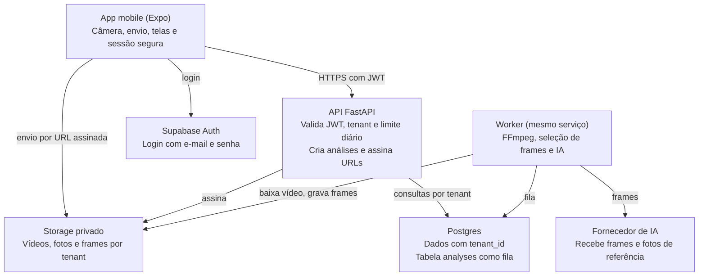
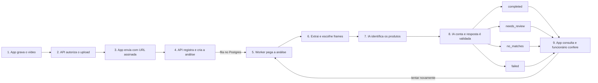

# ContaBot Mobile: arquitetura e plano de execução

Cópia de 10/11/2026. A versão viva, com comentários e diagramas editáveis, está em [Claude Docs](https://claude.ai/artifact/Pbv2vaWN9tYBGXTnoSPe9Y).

## Resumo

Vamos entregar em 20 dias um MVP funcional do ContaBot para Android e iPhone, feito por três pessoas. O funcionário entra com seu login, cadastra produtos com fotos, filma a prateleira e confere a contagem sugerida pela IA.

A arquitetura continua completa de ponta a ponta, mas cada peça usa a forma mais simples que funciona. O que não é necessário para o fluxo principal foi para “Evolução depois do MVP”, no fim deste documento.

**O MVP está pronto quando, em um celular real:**

1. O funcionário entra com e-mail e senha.
2. Cadastra um produto com fotos tiradas no app.
3. Grava um vídeo de até 60 segundos e o envia.
4. Vê a quantidade sugerida e as imagens usadas como evidência.
5. Corrige a quantidade, e a sugestão original continua guardada.
6. Um usuário de outra loja não enxerga nada disso.

**Premissas deste plano**

- **Prazo:** 20 dias de desenvolvimento, para trabalho da faculdade. A meta é ter o MVP funcionando por volta do Dia 14.
- **Equipe:** 3 das 6 pessoas do grupo, uma por frente.
- **Reaproveitamento:** app, banco e API são novos. O processamento de vídeo e a validação de IA partem do código já testado do MVP web.
- **Distribuição:** APK no Android e Expo Go no iPhone, sem publicar nas lojas agora.
- **Conexão:** uso exclusivamente online, sem banco local nem sincronização.

## Decisões de arquitetura

O MVP usa um app Expo, um único serviço Python e o plano Free do Supabase. Isso elimina a maior parte da infraestrutura e deixa as três pessoas focadas no fluxo de contagem.

| Área | Decisão no MVP | Por que é o caminho rápido |
| --- | --- | --- |
| App | [Expo SDK 58](https://expo.dev/changelog/sdk-58), TypeScript, Expo Router e TanStack Query | Uma base para Android e iPhone, com consulta periódica pronta |
| Vídeo | [expo-camera](https://docs.expo.dev/versions/latest/sdk/camera/) em 1080p, 6 Mbps e até 60 segundos, cerca de 45 MB | Roda no Expo Go e cabe no limite do plano Free |
| Fotos | `expo-image-picker`, pela câmera ou galeria, salvas em JPEG | Evita tela de câmera própria para o catálogo |
| Distribuição | APK gerado pelo EAS no Android e Expo Go no iPhone | Dispensa conta paga e revisão das lojas |
| Upload | URL assinada direto ao storage, com o arquivo inteiro | O vídeo não passa pela API; em queda de rede, o app reenvia |
| Backend | Um serviço FastAPI em um container com FFmpeg | Um único deploy e uma única configuração |
| Worker | Thread no mesmo serviço, em módulo separado, uma análise por vez | Não trava a API e pode virar outro serviço depois |
| Fila | A própria tabela `analyses`, com `FOR UPDATE SKIP LOCKED` | Sobrevive a reinícios sem Redis |
| Banco | [Postgres do Supabase Free](https://supabase.com/docs/guides/storage/uploads/file-limits), com `tenant_id` nas tabelas e filtro em uma camada única da API | Isola as lojas sem escrever políticas para cada tabela |
| Proteção do banco | RLS ligado em todas as tabelas, sem políticas | Fecha o acesso público direto do Supabase com pouco esforço |
| Login | Supabase Auth com e-mail e senha; a API valida o token via [JWKS](https://supabase.com/docs/guides/auth/signing-keys) | Login pronto; usuários criados por script |
| Sessão | [expo-secure-store](https://docs.expo.dev/versions/latest/sdk/securestore/) | Keychain no iOS e Keystore no Android |
| IA | `gpt-5.6-luna` pela API, com chave só no backend e um simulador | Modelo barato, já usado no MVP, e testes sem custo |
| Contrato | Tabela deste documento e `/docs` automático do FastAPI | Elimina mock e geração de código |

**Decisões em aberto**

| Decisão | Recomendação | Necessária até |
| --- | --- | --- |
| Login por funcionário ou por loja | Um login por funcionário, com tenant por loja | Dia 1 |
| Catálogo por loja ou por rede | Catálogo separado por loja | Dia 1 |
| Repositório | Usar o repositório atual, marcando a versão web com a tag mvp-web | Decidido |
| Fornecedor e modelo de IA | Usar gpt-5.6-luna e validar com um vídeo real | Dia 2 |
| Hospedagem de API e worker | Serviço com Docker que não hiberne durante a análise | Dia 2 |
| Reaproveitar o processamento do MVP web | Copiar domain.py, video.py e, de providers.py, ResponsesProvider e MockProvider | Decidido |

## Arquitetura geral

O app só conversa com a API e com URLs assinadas do storage. Banco, fila e fornecedor de IA ficam atrás do backend e nunca são acessados pelo aparelho.



### Fluxo de uma contagem

O vídeo vai direto ao storage e a análise roda fora da requisição. Assim, a API responde rápido e uma análise interrompida volta para a fila ao reiniciar o serviço.



Cada nova análise do mesmo vídeo cria outra linha em `analyses`. A sugestão original e as correções ficam em campos separados.

### Tenant, login e permissões

- **Tenant:** cada loja é um tenant, e toda tabela de negócio carrega `tenant_id`.
- **Usuário:** cada funcionário tem um login próprio e pertence a uma única loja no MVP.
- **Criação de conta:** por script de seed, sem cadastro público nem convite.
- **Permissões:** todos os usuários da loja podem fazer tudo. Papéis ficam para depois.
- **Requisição:** a API valida o JWT e descobre o `tenant_id` pelo vínculo do usuário. O app nunca informa a loja.
- **Consultas:** todo acesso passa por um módulo de repositório que exige `tenant_id`. Um teste prova o isolamento entre lojas.
- **Arquivos:** bucket privado, com caminhos iniciados por `tenant_id` e acesso por URL assinada.

### Comunicação com a IA

- A chave do fornecedor existe apenas como variável de ambiente do backend. O app nunca a recebe.
- O worker envia somente frames selecionados e fotos de referência, nunca o vídeo completo.
- Duas operações compõem a análise: `identify` encontra os produtos e `count` conta os encontrados.
- A resposta passa por esquema estrito antes de ser salva. Resposta inválida vira falha registrada, nunca uma contagem.
- Tokens e modelo ficam salvos em `analyses.usage`, para medir o custo real.
- Um limite diário por loja protege os créditos da chave.

### Uso exclusivamente online

- O app não tem banco local. Sem conexão, ele mostra uma mensagem e bloqueia as ações.
- O vídeo gravado fica no aparelho até a API confirmar o registro, para o envio poder ser repetido.
- A gravação é limitada a 1080p, 60 segundos e 48 MB, abaixo dos 50 MB do plano Free.

### Regras de produto que continuam valendo

Estas regras foram aprendidas no MVP web e viram testes do novo backend.

- Contagens de frames sobrepostos nunca são somadas, porque podem repetir caixas.
- “Não identificado” e quantidade desconhecida não significam estoque zero.
- Sem cobertura completa, o resultado é parcial e exige revisão.
- Toda quantidade observada, inclusive zero, precisa apontar para frames de evidência.
- Não existe total entre vídeos, pois eles podem mostrar as mesmas caixas.
- Produto excluído sai de novas análises, mas o histórico e as fotos das análises antigas ficam preservados.

## Modelo de dados e contrato da API

São cinco tabelas e dez rotas, combinadas no Dia 1. Depois disso, qualquer mudança de contrato precisa ser avisada às outras frentes.

### Tabelas principais

| Tabela | Guarda | Campos importantes | Frente dona |
| --- | --- | --- | --- |
| `tenants` | Lojas | `name`, `daily_analysis_limit` | A |
| `memberships` | Vínculo usuário e loja | `user_id` (único), `tenant_id` | A |
| `skus` | Produtos | `tenant_id`, `name`, `variant`, `photo_paths`, `archived_at` | A |
| `videos` | Vídeos enviados | `tenant_id`, `created_by`, `filename`, `object_path`, `created_at` | A |
| `analyses` | Cada análise e fila de trabalho | `tenant_id`, `video_id`, `sku_ids`, `status`, `stage`, `locked_until`, `attempts`, `model`, `frames`, `result`, `usage`, `corrections`, `corrected_by`, `corrected_at`, `error` | B |

### Endpoints v1

Todas as rotas exigem `Authorization: Bearer <token>`. A loja vem do usuário autenticado, então não aparece na URL.

| Método e rota | Função | Resposta principal |
| --- | --- | --- |
| `GET /v1/me` | Usuário e loja | `user`, `tenant` |
| `POST /v1/uploads` | Autoriza um envio de `video` ou `photo` | `object_path`, `signed_url`, `token` |
| `GET /v1/skus` | Lista produtos ativos | Produtos com URLs assinadas |
| `POST /v1/skus` | Cria produto com 1 a 4 fotos enviadas | Produto criado |
| `DELETE /v1/skus/{id}` | Arquiva produto | 204 |
| `GET /v1/videos` | Lista os 50 vídeos mais recentes | Vídeos com estado |
| `POST /v1/videos` | Registra o vídeo e cria a análise | 202 com `video_id` |
| `GET /v1/videos/{id}` | Estado, resultados e frames | Análise atual |
| `POST /v1/videos/{id}/retry` | Cria nova análise | 202 |
| `PATCH /v1/videos/{id}/counts` | Salva quantidades conferidas | Análise atualizada |

**Convenções do contrato**

- Erros seguem `{ "code": "limit_exceeded", "message": "..." }`, com `message` pronto em português.
- Códigos usados: 401, 404, 409, 413, 422 e 429.
- O servidor gera o `object_path`. `POST /v1/videos` confere se ele pertence à loja e se o arquivo existe.
- O app consulta `GET /v1/videos/{id}` a cada 3 segundos até o estado final.
- Fotos e frames vêm como URLs assinadas de curta duração.

## Estrutura do repositório e padrões de trabalho

O projeto continua no repositório atual, reorganizado em uma branch nova. Assim, os módulos reaproveitados mantêm o histórico e os testes.

```text
contabot/
  mobile/                 App Expo: telas, câmera, envio e login
  backend/
    app/                  Rotas FastAPI, autenticação e repositório
    pipeline/             Frames, prompts, validação e adaptador de IA
    worker.py             Laço que processa a tabela analyses
    tests/                Isolamento, regras de produto e API
    Dockerfile            Python, FFmpeg e o serviço
  supabase/migrations/    Tabelas e RLS
  scripts/seed.py         Cria lojas e usuários da demonstração
```

**Transição no Dia 1**

1. Criar a tag `mvp-web` no estado atual da `main`, para a versão web continuar recuperável.
2. Em uma branch nova, mover com `git mv` os módulos reaproveitados para `backend/pipeline/`, junto com seus testes.
3. Criar `mobile/`, `backend/app/` e `supabase/migrations/`.
4. Remover a interface web, o adaptador do Codex e o teste no navegador.
5. Confirmar que as três pessoas têm acesso de escrita ao repositório.

**Padrões de trabalho**

- **Branches:** curtas, saindo da `main`, com merge no mesmo dia sempre que possível.
- **Revisão:** rápida e obrigatória só em banco, contrato e regras de contagem.
- **Ambientes:** local e um único ambiente publicado.
- **Banco:** toda alteração entra por migração em `supabase/migrations`.
- **Segredos:** chaves apenas em variáveis de ambiente, nunca no repositório ou no app.
- **Testes:** `pytest` no GitHub Actions, sempre com o simulador de IA.
- **Alinhamento:** 15 minutos por dia entre as três pessoas e demonstração nos Dias 2, 8, 14 e 18.

## Três frentes de trabalho

Cada pessoa é dona de uma frente e consegue avançar com dados simulados enquanto as outras terminam. Os responsáveis ainda precisam ser preenchidos.

| Frente | Responsável | É dona de | Perfil indicado |
| --- | --- | --- | --- |
| **A. Backend e dados** | A definir | Supabase, migrações, seed, login, API e URLs assinadas | Python e banco de dados |
| **B. Contagem e IA** | A definir | Worker, frames, IA, validação, medição de acerto, deploy e CI | Python e integração com IA |
| **C. App mobile** | A definir | Expo, login, câmera, envio, telas e APK | React Native e TypeScript |

**Pontos de integração**

| O que é entregue | De | Para | Até | Enquanto não chega |
| --- | --- | --- | --- | --- |
| Tabelas e contrato combinados | A | B e C | Dia 1 | Ninguém começa a integrar |
| Usuário de teste e bucket | A | C | Dia 2 | C usa URL assinada gerada à mão |
| Backend publicado | B | A e C | Dia 2 | Cada pessoa roda localmente |
| Simulador no formato final | B | A e C | Dia 5 | C usa um JSON fixo |
| Criação da análise pela API | A | B | Dia 6 | B insere linhas por script |
| Resultado com IA real | B | C | Dia 11 | C segue com o simulador |

## Etapas de execução

O fluxo completo fica de pé no Dia 8 com IA simulada, e o MVP fecha no Dia 14. Os últimos seis dias servem para testar com produtos reais e preparar a entrega.

| Etapa | Dias | Frente A | Frente B | Frente C | Marco |
| --- | --- | --- | --- | --- | --- |
| 0. Base | 1 e 2 | Banco, seed e contrato | Deploy e primeiro teste de IA | Expo, gravação e envio de teste | Vídeo no storage e IA respondendo |
| 1. Fluxo simulado | 3 a 8 | Login, produtos e vídeos | Frames, worker e IA simulada | Login, catálogo e gravação | Fluxo completo com IA simulada |
| 2. IA real e MVP | 9 a 14 | Correções e limite diário | IA real e validação | Resultado e primeiro APK | Fluxo principal funcionando |
| 3. Teste real | 15 a 18 | Falhas e dados da demonstração | Ajuste de prompt e medição | Ajustes de uso e APK final | Demonstração funcionando |
| 4. Entrega | 19 e 20 | Arquitetura no relatório | Resultados de acerto | Vídeo de demonstração | Trabalho entregue com plano B |

Os marcos servem para a equipe se situar. Se algo atrasar, ajustamos e seguimos.

### Etapa 0: base (Dias 1 e 2)

| ID | Frente | Entrega | Depende de | Resultado esperado |
| --- | --- | --- | --- | --- |
| E0.1 | Todos | Fechar decisões, tabelas e contrato | Nenhuma | Responsáveis e rotas definidos no Dia 1 |
| E0.2 | A | Repositório, Supabase, migrações e seed | E0.1 | Duas lojas e seus usuários existem |
| E0.3 | B | Serviço publicado e teste de IA com vídeo real | E0.1 | `/health` no ar e IA devolve JSON válido |
| E0.4 | C | App Expo gravando e enviando ao storage | E0.2 | Vídeo de 60 s sai de um Android e de um iPhone |

### Etapa 1: fluxo completo com IA simulada (Dias 3 a 8)

| ID | Frente | Entrega | Depende de | Resultado esperado |
| --- | --- | --- | --- | --- |
| E1.1 | A | Autenticação, tenant e repositório | E0.2 | Teste prova que uma loja não lê outra |
| E1.2 | A | Upload assinado e produtos | E1.1 | Produto criado com fotos do storage |
| E1.3 | A | Rotas de vídeo | E1.2 | Registrar vídeo cria uma análise |
| E1.4 | B | Trazer regras e extração de frames do MVP web | E0.3 | Vídeo de cada aparelho gera frames corretos |
| E1.5 | B | Worker com fila e simulador | E1.4 | Análise interrompida volta para a fila e termina |
| E1.6 | C | Login, sessão e abas | E0.4 | Sessão continua ao reabrir o app |
| E1.7 | C | Catálogo com fotos | E1.2 | Criar, listar e arquivar produto |
| E1.8 | C | Gravar, escolher produtos, enviar e acompanhar | E0.4, E1.3 | Vídeo filmado chega ao estado final |

**Marco do Dia 8:** o fluxo completo funciona no ambiente publicado, com IA simulada.

### Etapa 2: IA real e MVP completo (Dias 9 a 14)

| ID | Frente | Entrega | Depende de | Resultado esperado |
| --- | --- | --- | --- | --- |
| E2.1 | B | Identificação e contagem com IA real | E1.5 | Resultado validado e salvo com evidência |
| E2.2 | B | Testes das regras e registro de tokens | E2.1 | Regras cobertas no CI e custo visível |
| E2.3 | A | Correções e nova análise | E1.3 | Correção guarda autor e preserva a sugestão |
| E2.4 | A | Limite diário e erros padronizados | E1.3 | Excesso retorna 429 com mensagem clara |
| E2.5 | C | Tela de resultado, correção e imagens | E1.8 | Conferência completa no aparelho |
| E2.6 | C | Erros, permissões e sem conexão | E1.8 | Queda de rede não perde o vídeo |
| E2.7 | C | Primeiro APK | E2.5 | Instalado em um Android sem ambiente de desenvolvimento |

**Marco do Dia 14:** o fluxo principal do MVP está funcionando. A partir daqui, a prioridade é estabilizar.

### Etapa 3: teste real e ajustes (Dias 15 a 18)

| ID | Frente | Entrega | Depende de | Resultado esperado |
| --- | --- | --- | --- | --- |
| E3.1 | Todos | Gravar vídeos de produtos com contagem física | E2.7 | Pelo menos 10 vídeos registrados |
| E3.2 | B | Ajustar prompt e medir acerto | E3.1 | Tabela de acerto e custo por vídeo |
| E3.3 | A | Corrigir falhas e preparar dados da demonstração | E3.1 | Loja de demonstração pronta |
| E3.4 | C | Ajustes de uso e APK final | E3.1 | APK final instalado nos aparelhos da apresentação |

**Marco do Dia 18:** a demonstração completa está funcionando.

### Etapa 4: entrega (Dias 19 e 20)

| ID | Frente | Entrega | Depende de | Resultado esperado |
| --- | --- | --- | --- | --- |
| E4.1 | A | Arquitetura e segurança no relatório | E3.3 | Seções revisadas |
| E4.2 | B | Resultados de acerto e custo no relatório | E3.2 | Limitações descritas com dados |
| E4.3 | C | Vídeo da demonstração como plano B | E3.4 | Vídeo gravado e salvo |
| E4.4 | Todos | Ensaio e entrega | E4.1 a E4.3 | Apresentação ensaiada e trabalho entregue |

## Cortes, riscos e evolução

O escopo tem uma ordem de corte definida, para um atraso não comprometer o fluxo principal. A publicação nas lojas fica fora dos 20 dias, porque depende de contas, testadores e revisão externa.

### Se atrasar, cortar nesta ordem

1. Botão de nova análise.
2. Escolha de vídeo da galeria.
3. Visualizador de imagens com zoom.
4. Limite diário por loja, mantendo o limite de gastos no fornecedor.
5. Demonstração no iPhone, ficando só com Android.

Login, separação por loja, gravação, análise e correção não entram em corte.

### Riscos

| Risco | Impacto | Resposta |
| --- | --- | --- |
| Acerto da IA ruim com produtos reais | Demonstração fraca | Testar já no Dia 2, medir na Etapa 3 e apresentar as limitações com dados |
| Expo Go não atende no iPhone | Sem demonstração em iOS | Testar no Dia 2; se falhar, seguir só com Android |
| Vídeo passa de 50 MB | Upload recusado | Bitrate e `maxFileSize` definidos na gravação |
| Backend hiberna ou cai na apresentação | Demonstração interrompida | Abrir o serviço antes e ter vídeo gravado; backend local com túnel como reserva |
| Build do APK atrasa | Sem app instalável | Gerar o primeiro APK até o Dia 14 |
| Gasto inesperado com IA | Créditos acabam | Chave com limite de gastos e limite diário por loja |
| Integrante indisponível por provas | Frente parada | Revisão cruzada e folga dos Dias 15 a 18 |
| Vídeos captam pessoas | Exposição de dados pessoais | Filmar apenas produtos e prateleiras, sem rostos |

### Evolução depois do MVP

A arquitetura permite adicionar cada item sem refazer o que foi entregue.

| Item | No MVP | Evolução |
| --- | --- | --- |
| Lojas | APK e Expo Go | [App Store](https://developer.apple.com/support/enrollment/) e Google Play, com contas de organização |
| Consentimento de IA | Aviso aos participantes | Tela obrigatória, exigida pela regra [5.1.2(i)](https://developer.apple.com/app-store/review/guidelines/) da Apple |
| Exclusão de conta | Por script | Opção dentro do app, para a regra 5.1.1(v) |
| Testes do Google Play | Não usados | Conta pessoal exige [12 testadores por 14 dias](https://support.google.com/googleplay/android-developer/answer/14151465); app novo precisa de [target API 36](https://developer.android.com/google/play/requirements/target-sdk) |
| Usuários | Seed e uma loja por usuário | Convites, papéis e várias lojas |
| Isolamento | Filtro único na API | Políticas de RLS por tenant |
| Upload | Arquivo inteiro até 50 MB | [TUS retomável](https://supabase.com/docs/guides/storage/uploads/resumable-uploads) e plano Pro |
| Worker | Thread no serviço | Serviço separado e várias instâncias |
| Câmera | expo-camera | [VisionCamera](https://visioncamera.margelo.com/docs/visioncamera-vs-expo-camera), se HDR ou FPS atrapalharem |
| Operação | Um ambiente | Staging, alertas, backups e custo por loja |

### Pendências a validar

- Falta definir qual data é o Dia 1 e confirmar se a entrega cai no Dia 20.
- No iPhone, o bitrate do `expo-camera` só vale com codec definido. Verificar na E0.4.
- Não está confirmado se gravar sem áudio evita pedir permissão de microfone no iPhone.
- Confirmar se o projeto Free do Supabase pausa por inatividade e abri-lo antes da apresentação.
- O custo por vídeo ainda é estimativa e deve ser medido na E3.2.
- As regras da Apple foram lidas em resumo. Conferir o texto oficial antes de publicar.

### Fontes

Consultadas em novembro de 2026: [Expo SDK 58](https://expo.dev/changelog/sdk-58), [expo-camera](https://docs.expo.dev/versions/latest/sdk/camera/), [VisionCamera vs Expo Camera](https://visioncamera.margelo.com/docs/visioncamera-vs-expo-camera), [expo-file-system](https://docs.expo.dev/versions/latest/sdk/filesystem/), [expo-secure-store](https://docs.expo.dev/versions/latest/sdk/securestore/), [chaves de assinatura do Supabase](https://supabase.com/docs/guides/auth/signing-keys), [upload retomável do Supabase](https://supabase.com/docs/guides/storage/uploads/resumable-uploads), [limites de arquivo do Supabase](https://supabase.com/docs/guides/storage/uploads/file-limits), [regras da App Store](https://developer.apple.com/app-store/review/guidelines/), [inscrição na Apple](https://developer.apple.com/support/enrollment/), [target API do Google Play](https://developer.android.com/google/play/requirements/target-sdk) e [testes em contas pessoais do Google Play](https://support.google.com/googleplay/android-developer/answer/14151465).
