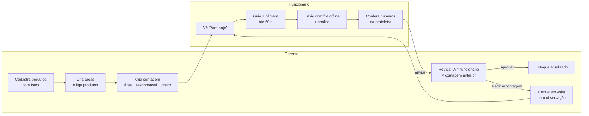
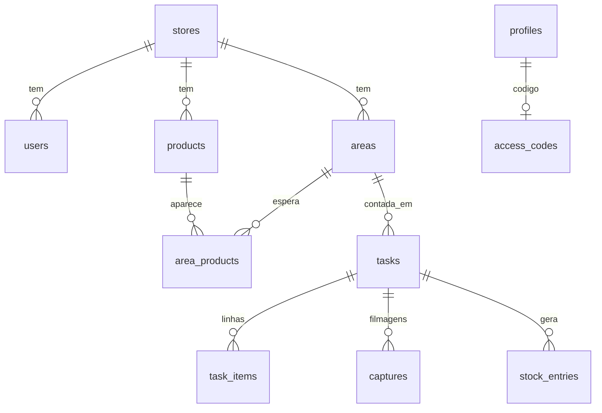

# Contabot v3 — arquitetura e contrato da API (Supabase)

Contabot passa a ser um **app mobile (Expo/React Native)** para duas pessoas:

| Papel | O que precisa | Onde no app |
| --- | --- | --- |
| **Gerente** | Montar o catálogo uma vez, dividir a loja em áreas, mandar contar, aprovar números e ver o estoque | Abas *Início · Contagens · Produtos · Áreas · Loja* |
| **Funcionário** | Saber o que contar hoje, filmar sem pensar, conferir a sugestão na frente da prateleira e enviar | Uma tela só: *Minhas contagens* → filmar → conferir → enviar |

O gerente também pode filmar (lojas pequenas): o fluxo de captura é o mesmo.

## Fluxos



Princípios:

1. **Nunca há beco sem saída.** Se a análise falhar ou não reconhecer nada, o funcionário cai na conferência com os campos vazios e pode filmar de novo ou contar manualmente.
2. **A IA sugere, pessoas decidem.** Itens sem dúvida chegam preenchidos; itens parciais/não encontrados exigem um toque explícito. O gerente vê o que mudou.
3. **Área define o catálogo da filmagem.** O funcionário não escolhe SKUs; a área já sabe quais produtos esperar (menos custo e mais precisão).
4. **Sem e-mail para funcionário.** O gerente gera um código de acesso (texto + QR com o endereço do servidor). Escaneou, entrou.
5. **Vídeo não se perde.** A gravação é copiada para o armazenamento do app e entra numa fila de envio que se repete quando a conexão volta.

## Modelo de dados (Postgres no Supabase)



`profiles` estende `auth.users` (sessões e senhas ficam no Supabase Auth). `access_codes` guarda só o hash SHA-256 do código do funcionário. Todas as tabelas têm RLS: um membro ativo lê apenas os dados da própria loja, e **nenhuma escrita é feita direto nas tabelas**. Toda mutação passa pelas RPCs abaixo, que validam papel, loja e transição de estado. Mídias ficam no bucket privado `media`, em `{store_id}/products/...` e `{store_id}/captures/{capture_id}/{frame}.jpg`. O Storage tem políticas por pasta de loja, e só o gerente envia fotos de produto.

Status da contagem (`tasks.status`):

| status | Significado | Próxima ação |
| --- | --- | --- |
| `open` | A fazer (ou recontagem pedida, `recount_requested=true`) | Funcionário filma ou conta manualmente |
| `analyzing` | Celular escolhendo/enviando quadros, depois IA trabalhando | Aguardar (app consulta a cada 1,5 s) |
| `review` | Sugestão pronta (ou falhou) — funcionário confere | Funcionário envia |
| `submitted` | Aguardando gerente | Aprovar ou pedir recontagem |
| `approved` | Concluída; estoque gravado | — |

Uma captura que para de avançar expira sozinha: 15 minutos sem os quadros (app fechado ou sem conexão) ou 10 minutos parada na análise. Quando alguém lista ou abre as contagens da loja, ela é marcada como falha e a contagem volta para a conferência manual. Cada loja tem um limite de capturas em 24 horas (`stores.daily_capture_limit`, padrão 30); ao atingi-lo, `start_capture` recusa novas análises, mas a contagem manual continua disponível.

Status sugerido de cada produto (`task_items.ai_status`):

| ai_status | Origem | Na conferência |
| --- | --- | --- |
| `ok` | Contagem completa, sem pedido de revisão | Pré-preenchido e pré-confirmado |
| `check` | Contagem parcial ou marcada para revisão | Pré-preenchido, exige confirmação |
| `missing` | Não encontrado / incerto / sem quantidade | Vazio, exige número |
| `manual` | Sem análise (falha ou contagem manual) | Vazio, exige número |

## API

O app usa `supabase-js`: **RPCs** (`supabase.rpc(nome, args)`) para dados e regras de negócio, **Edge Functions** para o que exige service role, e **Storage** para imagens. As RPCs devolvem o mesmo JSON do antigo backend FastAPI. Erros vêm em `error.message` (RPC) ou `{"detail": "..."}` (Edge Function), sempre em português. Datas ISO‑8601 UTC; `due_date` é `YYYY-MM-DD`. Campos de imagem trazem o caminho no bucket; o app (`services/api.ts`) troca por URLs assinadas válidas por 1 h.

### Objetos

```ts
User    = { id, name, role: 'manager'|'employee', email: string|null, active: boolean, created_at }
Store   = { id, name }
Product = { id, name, variant, barcode, min_stock: number|null, photos: string[],
            stock: number|null, last_counted_at: string|null, low_stock: boolean, area_ids: string[] }
Area    = { id, name, description, product_ids: string[], product_count: number,
            last_counted_at: string|null, open_task_id: string|null }
TaskSummary = { id, area_id, area_name, status, recount_requested: boolean, due_date: string|null,
                overdue: boolean, assignee: {id,name}|null, note, manager_note,
                item_count: number, attention_count: number,   // itens check/missing ainda não conferidos
                created_at, updated_at, submitted_at: string|null, approved_at: string|null,
                submitted_by: {id,name}|null }
TaskItem = { product_id, name, variant, photo: string|null,
             ai_quantity: number|null, ai_status: 'ok'|'check'|'missing'|'manual', ai_note: string,
             evidence_frame: string|null,          // URL do frame que embasou o número
             counted: number|null,                 // conferido pelo funcionário
             final: number|null,                   // aprovado pelo gerente
             previous: number|null }               // última contagem aprovada desta área
Capture  = { id, status: 'processing'|'done'|'failed', stage: 'frames'|'identifying'|'counting'|null,
             error: string|null, frames: [{id, url, timestamp_seconds}],   // quadros usados na contagem
             unknown_products: string[], simulated: boolean, created_at, by: {id,name} }
TaskDetail = TaskSummary & { items: TaskItem[], capture: Capture|null, capture_count: number,
             area: {id,name,description}, events: [{at, text}] }
```

### RPCs e Edge Functions

| Chamada | Quem | Argumentos → resposta | Antes (FastAPI) |
| --- | --- | --- | --- |
| `auth.signUp` | público | `{email,password, options.data:{name,store_name}}`; gatilho cria loja + gerente | `POST /auth/register` |
| `auth.signInWithPassword` | público | `{email,password}` | `POST /auth/login` |
| fn `join-store` | público | `{code}` → `{token_hash}`; app chama `auth.verifyOtp({token_hash,type:'magiclink'})` | `POST /auth/join` |
| `whoami` | todos | → `{user,store}` | `GET /me` |
| `list_team` | gerente | → `User[]` (com `open_tasks`) | `GET /team` |
| fn `create-employee` | gerente | `{name}` → `{user, access_code}` | `POST /team` |
| `regenerate_access_code` | gerente | `p_user_id` → `{user, access_code}` (o anterior deixa de valer; sessões encerradas) | `POST /team/{id}/code` |
| `deactivate_member` | gerente | `p_user_id`: desativa, apaga o código, encerra as sessões | `DELETE /team/{id}` |
| `list_products` / `get_product` | todos | → `Product[]` / `Product & {history}` | `GET /products[/{id}]` |
| `create_product` | gerente | `p_name, p_photos[1..4] (caminhos já enviados), p_variant?, p_barcode?, p_min_stock?` → `Product` | `POST /products` |
| `update_product` | gerente | `p_id` + campos opcionais (`null` mantém) → `Product` | `PATCH /products/{id}` |
| `archive_product` | gerente | `p_id` | `DELETE /products/{id}` |
| `list_areas` / `get_area` | todos | → `Area[]` / `Area & {products}` | `GET /areas[/{id}]` |
| `create_area` / `update_area` / `delete_area` | gerente | `p_name, p_description?, p_product_ids` | `POST/PATCH/DELETE /areas` |
| `list_tasks` | todos | `p_scope: mine\|all, p_statuses?` → `TaskSummary[]` | `GET /tasks` |
| `create_tasks` | todos | `p_area_ids, p_assignee_id?, p_due_date?, p_note?` → `TaskSummary[]` | `POST /tasks` |
| `get_task` | todos | `p_id` → `TaskDetail` | `GET /tasks/{id}` |
| `start_capture` | todos | `p_task_id` → `{capture_id, upload_prefix}` (contagem vai para `analyzing`) | `POST /tasks/{id}/captures` |
| `register_capture_frames` | quem iniciou | `p_capture_id, p_frames, p_selected_frame_ids, p_primary_frame_id, p_selection` | — |
| fn `analyze-capture` | todos | `{capture_id}` → 202; identificar → contar em segundo plano | (fila do backend) |
| `fail_capture` | todos | `p_capture_id, p_error` → `TaskDetail` (conferência manual) | — |
| `switch_to_manual` | todos | `p_id` → `TaskDetail` (também cancela captura pendente) | `POST /tasks/{id}/manual` |
| `submit_task` | todos | `p_id, p_counts:{product_id:int\|null}` → `TaskDetail` | `POST /tasks/{id}/submit` |
| `approve_task` | gerente | `p_id, p_counts?` → `TaskDetail` | `POST /tasks/{id}/approve` |
| `request_recount` | gerente | `p_id, p_note` → `TaskDetail` | `POST /tasks/{id}/recount` |
| `update_task` | gerente | `p_id, p_patch:{assignee_id?,due_date?,note?}` (`null` limpa) → `TaskDetail` | `PATCH /tasks/{id}` |
| `delete_task` | gerente | `p_id` (só se não aprovada) | `DELETE /tasks/{id}` |
| `get_dashboard` | gerente | → `{counts, to_approve, low_stock, stale_areas, recent}` | `GET /dashboard` |

`pipeline_claim`, `pipeline_set_stage`, `pipeline_finish` e `pipeline_fail` são exclusivas do service role (Edge Function).

## Pipeline de visão

**No celular** (`mobile/src/services/capture.ts` + `supabase/functions/_shared/frame-selection.ts`): o `expo-video` gera ~1 quadro/s (até 120 candidatos). Cada quadro é reduzido a 640 px e decodificado em JS (`jpeg-js`) para calcular as mesmas heurísticas do antigo `video.py` (OpenCV): variância do Laplaciano, exposição, reflexo, movimento e uma assinatura (miniatura 32×18 + difference hash). Com elas, o app escolhe até 5 quadros de identificação (melhor qualidade por faixa temporal, sem quase idênticos) e completa com vizinhos a ±2/4/6 s (até 20 quadros), enviados em JPEG ≤ 1920 px. Diferenças em relação ao OpenCV:
- a nitidez é medida a 640 px em vez de 960 px, então os valores absolutos mudam de escala;
- o "movimento" compara candidatos consecutivos (≈1 s), não quadros adjacentes do vídeo;
- a orientação vem do decodificador da plataforma, sem `ffprobe`.

Os limites de aviso continuam heurísticas não calibradas.

**No servidor** (`supabase/functions/analyze-capture`): faz **identificar → contar** com os mesmos prompts e as mesmas regras de validação estrita de `domain.py` (`_shared/vision.ts`). Os quadros da contagem são escolhidos entre os enviados pelo celular (`selectCountingFrames`). Cada etapa roda numa invocação própria, em segundo plano, para caber no limite de tempo das Edge Functions. `pipeline_claim` impede análise duplicada. O provedor é qualquer API compatível com OpenAI Chat Completions, configurada por `VISION_*`, ou `mock`.
